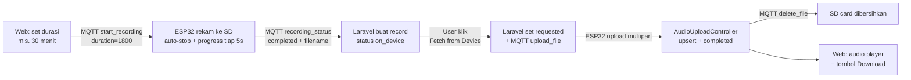

# Panduan Merekam Audio dengan ESP32 ke SD Card

Great job berhasil mengakses SD Card! Untuk merekam audio, kita perlu menambahkan perangkat keras mikrofon dan sedikit logika perangkat lunak untuk menyimpan data suara dalam format yang bisa diputar (WAV).

## 0. Arsitektur Recording On-Demand (BARU)

Rekaman sekarang berjalan **sepenuhnya di perangkat** — tidak ada transaksi file selama perekaman:



Poin penting:
- **Durasi diatur dari web** (menit, 0 = rekam sampai dihentikan manual). Dikirim per-sesi via MQTT `start_recording` payload `duration` (detik). Maksimum 14400 detik (4 jam); 30 menit ≈ 57,6 MB WAV (16000 Hz × 2 byte).
- **Tanpa putus-putus**: ESP32 menulis langsung ke SD card dengan DMA buffer besar; Laravel hanya menerima progress tiap 5 detik via topik `audio/{device_id}/recording_status`.
- **Upload on-demand**: file hanya dikirim ke Laravel saat user klik "Fetch from Device" di halaman device. Setelah tersimpan, Laravel otomatis mengirim `delete_file` agar SD card tidak penuh.
- **Status rekaman di DB**: `on_device` (file di SD), `requested` (upload diminta), `uploading`, `completed` (tersimpan di server), `upload_failed`.

## 1. Perangkat Keras (Hardware)

Anda membutuhkan mikrofon dengan antarmuka **I2S**. Mikrofon analog biasa sulit digunakan untuk kualitas audio yang baik dengan ESP32 tanpa komponen tambahan.

**Rekomendasi Modul:**
- **INMP441** (Paling umum & mudah digunakan)
- **MSM261S4030H0**

**Koneksi Pin (Wiring) untuk INMP441:**

| INMP441 Pin | ESP32 Pin (dari `esp32_firmware_complete.ino`) | Keterangan |
| :--- | :--- | :--- |
| VDD | 3.3V | Daya |
| GND | GND | Ground |
| SD | GPIO 33 | Serial Data (I2S_SD) |
| WS | GPIO 25 | Word Select (I2S_WS) |
| SCK | GPIO 32 | Serial Clock (I2S_SCK) |
| L/R | GND | Channel Select (Left) |

*Catatan: Pin SD Card tetap sama (CS=5, MOSI=23, MISO=19, SCK=18).*

## 2. Logika Perangkat Lunak (Code)

Anda sebenarnya sudah memiliki kode yang sangat lengkap di folder project Anda:
`esp32_firmware_complete.ino`

Berikut adalah inti dari cara kerjanya:

### A. Setup I2S
Kita mengkonfigurasi I2S untuk membaca data dari mikrofon dengan kecepatan sampling tertentu (misalnya 16000Hz).
```cpp
// Konfigurasi I2S
const i2s_config_t i2s_config = {
    .mode = (i2s_mode_t)(I2S_MODE_MASTER | I2S_MODE_RX), // Receive mode
    .sample_rate = 16000,
    ...
};
```

### B. Format File WAV (PENTING!)
Jika kita hanya menulis data mentah (raw data) ke SD card, file tersebut tidak akan bisa diputar oleh player biasa. Kita harus menambahkan **WAV Header** (44 bytes di awal file) yang memberi tahu player tentang format audio (sample rate, mono/stereo, bit depth).

Lihat `struct WAVHeader` di dalam file `esp32_firmware_complete.ino`.

### C. Alur Perekaman
1. Buka file di SD Card (`SD.open`).
2. Tulis **Header Kosong** terlebih dahulu (sebagai tempat reservasi).
3. Baca data dari I2S (`i2s_read`) dan tulis ke file secara berulang (Looping).
4. Setelah selesai, hitung ukuran file total.
5. Kembali ke awal file (`file.seek(0)`) dan **update Header** dengan ukuran file yang benar.
6. Tutup file.

## 3. Cara Menggunakan
1. Pasang mikrofon INMP441 sesuai tabel wiring di atas.
2. Buka `esp32_firmware_complete.ino` di Arduino IDE.
3. Pastikan library `ArduinoJson` dan `PubSubClient` terinstall.
4. Upload ke ESP32.
5. Buka halaman device di web, isi durasi (menit) lalu klik **Start Recording** — atau gunakan tombol mini di dashboard.
6. Pantau progress bar realtime di halaman device. Saat selesai, rekaman muncul di tabel dengan status **On SD Card**.
7. Klik **Fetch from Device** untuk meminta upload. Halaman otomatis reload saat upload selesai dan audio player + tombol Download muncul.

Perintah MQTT yang didukung firmware:
| Action | Payload | Keterangan |
| :--- | :--- | :--- |
| `start_recording` | `{"duration": 1800}` | Mulai rekam; `duration` dalam detik, 0 = sampai dihentikan |
| `stop_recording` | — | Hentikan rekaman manual |
| `upload_file` | `{"filename": "/rec_XXX.wav"}` | Upload file dari SD ke server |
| `delete_file` | `{"filename": "/rec_XXX.wav"}` | Hapus file dari SD card |

Catatan server: pastikan `php.ini` memiliki `upload_max_filesize` dan `post_max_size` yang cukup (sudah diset 512M/520M di XAMPP). Jika memakai Apache, restart setelah mengubah `php.ini`.

Jika Anda ingin versi yang lebih sederhana hanya untuk tes rekam tanpa MQTT/WiFi, Anda bisa melihat `esp32_firmware_recording.ino`, namun Anda perlu menambahkan logika **WAV Header** agar file hasil rekaman bisa diputar di laptop.
