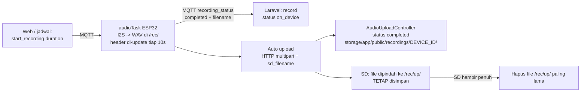

# Panduan Merekam Audio dengan ESP32 ke SD Card

Great job berhasil mengakses SD Card! Untuk merekam audio, kita perlu menambahkan perangkat keras mikrofon dan sedikit logika perangkat lunak untuk menyimpan data suara dalam format yang bisa diputar (WAV).

## 0. Arsitektur Recording: SD Card + Server (firmware v3.2)

Setiap rekaman disimpan **dua kali**: di micro SD card ESP32 dan di server Laravel.



Poin penting:
- **Rekam tanpa putus**: I2S + tulis SD berjalan di FreeRTOS task terpisah (`audioTask`). Reconnect WiFi/MQTT atau upload tidak mengganggu rekaman, dan perangkat bisa merekam file baru sambil meng-upload file sebelumnya.
- **Nama file unik berbasis waktu NTP (WIB)**: `/rec/<DEVICE_ID>_<YYYYMMDD>_<HHMMSS>.wav`. Jika NTP belum sinkron, dipakai boot counter (`..._boot00012_...`), jadi file lama tidak pernah tertimpa setelah reboot.
- **Tahan listrik mati**: header WAV di-update tiap 10 detik, sehingga file tetap bisa diputar.
- **Auto upload + retry**: setelah rekaman selesai, file langsung di-upload. Jika server mati, dicoba ulang dengan backoff 1 menit hingga 30 menit. Saat boot, file yang belum ter-upload juga dikirim.
- **Server upload**: default `https://dev.nhmedia.pro` (port 443 = HTTPS, port lain = HTTP). Bisa diganti dari halaman device → *WiFi & Server* (kosongkan SSID untuk mengganti server saja, tanpa restart). Device lama yang masih menyimpan `192.168.97.91` otomatis pindah ke domain saat firmware baru pertama kali boot.
- **Upload bertahap (chunked)**: file dikirim per 8 MB karena Cloudflare menolak request di atas 100 MB. Server menyambung potongan di `storage/app/private/chunks/` lalu memindahkannya ke `recordings/` saat potongan terakhir tiba. Jika koneksi putus, upload diulang dari awal pada percobaan berikutnya.
- **Folder di SD card**: `/rec/` berisi rekaman yang **belum** ter-upload, `/rec/up/` berisi rekaman yang **sudah** ada di server (salinan cadangan). File lama firmware v2 di root SD otomatis dipindah ke `/rec/`.
- **SD card tidak penuh**: sebelum merekam, firmware memastikan ada ruang. Jika kurang, rekaman lama yang **sudah ter-upload** dihapus lebih dulu. Rekaman yang belum ter-upload tidak pernah dihapus otomatis; jika tetap penuh, perangkat mengirim status `sd_full`.
- **Opsi hapus dari SD setelah upload**: Settings → *Audio Recording Storage*. Default **mati** (file disimpan di SD dan server).
- **Fetch from Device** tetap tersedia untuk meminta upload manual (misalnya setelah `upload_failed`).
- **Status rekaman di DB**: `on_device` (baru di SD), `requested`, `uploading`, `completed` (ada di server), `upload_failed`.
- Durasi maksimum 4 jam per file (termasuk mode manual), sekitar 460 MB.

## 1. Perangkat Keras (Hardware)

Anda membutuhkan mikrofon dengan antarmuka **I2S**. Mikrofon analog biasa sulit digunakan untuk kualitas audio yang baik dengan ESP32 tanpa komponen tambahan.

**Rekomendasi Modul:**
- **INMP441** (Paling umum & mudah digunakan)
- **MSM261S4030H0**

**Koneksi Pin (Wiring) untuk INMP441:**

| INMP441 Pin | ESP32 Pin (dari `esp32_firmware_complete/esp32_firmware_complete.ino`) | Keterangan |
| :--- | :--- | :--- |
| VDD | 3.3V | Daya |
| GND | GND | Ground |
| SD | GPIO 33 | Serial Data (I2S_SD) |
| WS | GPIO 25 | Word Select (I2S_WS) |
| SCK | GPIO 32 | Serial Clock (I2S_SCK) |
| L/R | GND | Channel Select (Left) |

*Catatan: Pin SD Card tetap sama (CS=5, MOSI=23, MISO=19, SCK=18).*

## 2. Logika Perangkat Lunak (Code)

Anda sebenarnya sudah memiliki kode yang sangat lengkap di folder project Anda:
`esp32_firmware_complete/esp32_firmware_complete.ino`

Berikut adalah inti dari cara kerjanya:

### A. Setup I2S
Kita mengkonfigurasi I2S untuk membaca data dari mikrofon dengan kecepatan sampling tertentu (misalnya 16000Hz).
```cpp
// Konfigurasi I2S
const i2s_config_t i2s_config = {
    .mode = (i2s_mode_t)(I2S_MODE_MASTER | I2S_MODE_RX), // Receive mode
    .sample_rate = 16000,
    ...
};
```

### B. Format File WAV (PENTING!)
Jika kita hanya menulis data mentah (raw data) ke SD card, file tersebut tidak akan bisa diputar oleh player biasa. Kita harus menambahkan **WAV Header** (44 bytes di awal file) yang memberi tahu player tentang format audio (sample rate, mono/stereo, bit depth).

Lihat `struct WAVHeader` di dalam file `esp32_firmware_complete/esp32_firmware_complete.ino`.

### C. Alur Perekaman
1. Buka file di SD Card (`SD.open`).
2. Tulis **Header Kosong** terlebih dahulu (sebagai tempat reservasi).
3. Baca data dari I2S (`i2s_read`) dan tulis ke file secara berulang (Looping).
4. Setelah selesai, hitung ukuran file total.
5. Kembali ke awal file (`file.seek(0)`) dan **update Header** dengan ukuran file yang benar.
6. Tutup file.

## 3. Cara Menggunakan
1. Pasang mikrofon INMP441 sesuai tabel wiring di atas.
2. Buka `esp32_firmware_complete/esp32_firmware_complete.ino` di Arduino IDE.
3. Pastikan library `ArduinoJson` dan `PubSubClient` terinstall.
4. Upload ke ESP32.
5. Buka halaman device di web, isi durasi (menit) lalu klik **Start Recording** — atau gunakan tombol mini di dashboard.
6. Pantau progress bar realtime di halaman device. Saat selesai, rekaman muncul di tabel dengan status **On SD Card**.
7. Klik **Fetch from Device** untuk meminta upload. Halaman otomatis reload saat upload selesai dan audio player + tombol Download muncul.

Perintah MQTT yang didukung firmware (`audio/<DEVICE_ID>/command`). Semua tersedia sebagai tombol di halaman device (kartu **Device Health & SD Card**):
| Action | Payload | Keterangan |
| :--- | :--- | :--- |
| `start_recording` | `{"duration": 1800}` | Mulai rekam; `duration` dalam detik, 0 = sampai dihentikan (maks 4 jam) |
| `stop_recording` | — | Hentikan rekaman manual |
| `upload_file` | `{"filename": "/rec/XXX.wav"}` | Upload satu file dari SD ke server (dicari juga di `/rec/up/`) |
| `upload_all` | `{"force": false}` | Upload semua file yang belum ter-upload sekarang juga. `force: true` = upload ulang semua file di SD |
| `list_files` | — | Kirim daftar file SD ke `audio/<ID>/files`; Laravel menyinkronkan kolom *Storage* (SD ✓/✗) dan mendaftarkan file yang belum dikenal |
| `get_status` | — | Kirim laporan health sekarang |
| `delete_uploaded` | — | Hapus semua file di `/rec/up/` (sudah aman di server) untuk mengosongkan SD |
| `delete_file` | `{"filename": "/rec/XXX.wav"}` | Hapus satu file dari SD card |
| `set_auto_upload` | `{"enabled": false}` | Matikan/nyalakan auto upload (disimpan di NVS) |
| `restart` | — | Restart perangkat (rekaman aktif ditutup dengan benar dulu) |
| `update_wifi` / `set_server` | `{"server_ip": "dev.nhmedia.pro", "server_port": 443, "ssid": "", "password": ""}` | Ganti server upload; jika `ssid` diisi, WiFi juga diganti dan perangkat restart |

Topik yang dikirim perangkat:
| Topik | Isi |
| :--- | :--- |
| `audio/<ID>/data` | dB SPL + FFT tiap 1 detik (`status: recording` saat merekam, Last Will `offline`) |
| `audio/<ID>/recording_status` | `recording`, `completed`, `uploading` (+`progress`), `upload_completed`, `upload_failed` (+`error`), `file_deleted`, `upload_all_started`, `upload_all_done`, `sd_cleaned`, `sd_full`, `sd_error`, `restarting`, `idle` |
| `audio/<ID>/health` | Tiap 60 detik, *retained*: versi firmware, uptime, alasan reset, RAM, sinyal WiFi, sinkron NTP, kapasitas & sisa SD, jumlah file belum/sudah ter-upload, waktu tulis SD terlama, jumlah tulis lambat (>300 ms, risiko audio terputus), error tulis, status upload & error terakhir, gain |
| `audio/<ID>/files` | Jawaban `list_files`, 25 file per pesan |

Gain dari slider web disimpan di NVS perangkat, dan Laravel mengirim ulang gain dari database setiap kali perangkat kembali online.

Catatan server: pastikan `php.ini` memiliki `upload_max_filesize` dan `post_max_size` yang cukup (sudah diset 512M/520M di XAMPP). Jika memakai Apache, restart setelah mengubah `php.ini`.

Jika Anda ingin versi yang lebih sederhana hanya untuk tes rekam tanpa MQTT/WiFi, Anda bisa melihat `esp32_firmware_recording.ino`, namun Anda perlu menambahkan logika **WAV Header** agar file hasil rekaman bisa diputar di laptop.
